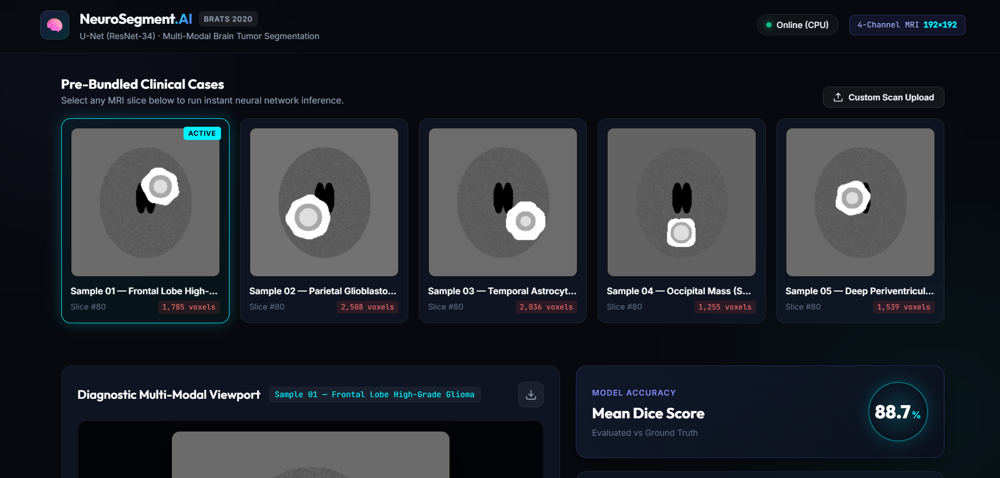

# Brain Tumor Segmentation

[](https://pytorch.org/)
[](https://fastapi.tiangolo.com/)
[](https://www.med.upenn.edu/cbica/brats2020/)
[-6366F1.svg>)](#model-details--performance)
[](LICENSE)

> **⚠️ Research and educational use only. Not a medical device and not validated for clinical use.**

A full-stack deep learning web application for automated multi-modal brain tumor segmentation trained on the **BraTS 2020 (MICCAI)** dataset. Built with **PyTorch**, **FastAPI**, and a custom dark-theme web UI featuring interactive canvas overlays, real-time opacity controls, and Sørensen–Dice evaluation.

---

## Web UI



---

## Features

- **Demo samples:** Ships with pre-extracted sample cases (`demo_samples/`) ready for single-click inference — no external datasets required.
- **Multi-region segmentation:** Simultaneously segments all three BraTS sub-regions — Whole Tumor (WT), Tumor Core (TC), and Enhancing Tumor (ET).
- **Interactive canvas:** Slice viewport with per-region layer toggles, opacity slider, and PNG export.
- **Dice evaluation:** Sørensen–Dice scores against ground-truth segmentations (shown only when a ground-truth mask is available).
- **NIfTI upload:** Ingests raw `.nii` / `.nii.gz` scans (T1, T1ce, T2, FLAIR + optional seg), extracts the optimal axial slice, and applies z-score normalization.
- **Array upload:** Ingests preprocessed `.npy` 4-channel tensor slices `[4, 192, 192]`.

---

## Project Structure

```
brain-tumor-segmentation/
├── ckpt/
│   ├── best.pth                    # Trained U-Net model weights (state dict)
│   └── last.pth
├── demo_samples/                   # Bundled sample cases for demo
│   ├── manifest.json               # Catalog of cases with tumor metadata
│   ├── sample_01_input.npy         # 4-channel float32 slice [4, 192, 192]
│   ├── sample_01_gt.npy            # 3-channel ground truth [3, 192, 192]
│   ├── sample_01_preview.png       # Grayscale thumbnail for gallery
│   └── ...
├── app/                            # Backend (FastAPI)
│   ├── __init__.py
│   ├── model.py                    # U-Net architecture & checkpoint loader
│   ├── inference.py                # Forward pass & Sørensen-Dice engine
│   ├── preprocess.py               # NIfTI & NPY z-score normalization
│   ├── main.py                     # FastAPI REST API endpoints
│   └── requirements.txt            # Python dependencies
├── frontend/                       # Web client (Vanilla HTML/CSS/JS)
│   ├── index.html
│   ├── style.css
│   └── app.js
├── scripts/
│   └── extract_demo_samples.py     # Sample extractor & synthetic case generator
├── training_curves.png
└── README.md
```

---

## Medical Imaging & Tumor Nomenclature

The model ingests **four co-registered MRI sequences**:

| Modality        | Description                         | Role                                                     |
| --------------- | ----------------------------------- | -------------------------------------------------------- |
| **T1**    | T1-weighted spin-echo               | Anatomic baseline, tissue boundaries                     |
| **T1ce**  | T1-weighted contrast-enhanced       | Highlights blood-brain barrier disruption & active tumor |
| **T2**    | T2-weighted spin-echo               | Highlights edema and fluid accumulation                  |
| **FLAIR** | Fluid-Attenuated Inversion Recovery | Suppresses CSF, delineates peritumoral edema             |

### Tumor Sub-Region Hierarchy

```
┌────────────────────────────────────────────────────────┐
│  Whole Tumor (WT): Red (#FF5353)                       │
│  ┌──────────────────────────────────────────────────┐  │
│  │  Tumor Core (TC): Green (#10B981)                │  │
│  │  ┌────────────────────────────────────────────┐  │  │
│  │  │  Enhancing Tumor (ET): Cyan (#00D2FF)     │  │  │
│  │  └────────────────────────────────────────────┘  │  │
│  └──────────────────────────────────────────────────┘  │
└────────────────────────────────────────────────────────┘
```

- **Whole Tumor (WT):** BraTS labels `1 + 2 + 3` (original BraTS label 4 is remapped to 3).
- **Tumor Core (TC):** BraTS labels `1 + 3`.
- **Enhancing Tumor (ET):** BraTS label `3`.

---

## Model Details & Performance

- **Architecture:** U-Net with a **ResNet-34 encoder trained from scratch** (`segmentation-models-pytorch`, `encoder_weights=None`).
- **Input:** `[Batch, 4, 192, 192]` — axial slices, z-score normalized on non-zero voxels.
- **Output:** 3 independent sigmoid outputs (WT, TC, ET), threshold 0.5.
- **Loss:** Soft Dice Loss + Binary Cross-Entropy (BCE).

### Validation Results (patient-level split, 74 patients)

| Tumor Region         | Validation Dice |
| -------------------- | :-------------: |
| Whole Tumor (WT)     |      0.880      |
| Tumor Core (TC)      |      0.723      |
| Enhancing Tumor (ET) |      0.705      |
| **Mean**       | **0.769** |

> These scores are computed on 2D axial slices containing tumor pixels, not on 3D volumes, so they are not directly comparable to BraTS leaderboard scores.


---

## Training Details

- **Data:** BraTS 2020 training set, 368 patients (1 excluded: non-standard segmentation filename); patient-level split — 294 train / 74 val (seed 42).
- **Preprocessing:** Per-volume z-score normalization on non-zero voxels, 192×192 center crop, axial slices with ≥100 tumor pixels retained.
- **Model:** U-Net, ResNet-34 encoder trained from scratch (24.4M params), 4 input channels, 3 sigmoid outputs.
- **Training:** AdamW (lr 1e-4), cosine LR schedule, batch size 16, mixed precision (AMP), Dice + BCE loss, Kaggle GPU; best checkpoint selected at epoch 5 by validation Dice.
- **Notebook:** [brain-tumor-segmentation.ipynb](brain-tumor-segmentation.ipynb)

---

## Limitations

- Dice is computed on 2D slices that contain tumor (192×192 crop), not per-patient 3D volumes, so it is not comparable to official BraTS leaderboard scores.
- The best checkpoint (epoch 5) was selected on the same validation set used for reporting; there is no separate held-out test set.
- The model tends to overfit after ~5–10 epochs (no data augmentation was applied).
- The app segments a single representative axial slice, not the full 3D volume.

---

## Quickstart

### Prerequisites

- Python 3.10 (tested on Python 3.10)
- CPU or CUDA GPU (detected automatically)

### Installation

```bash
# Clone the repository
git clone https://github.com/iAhmeed/brain-tumor-segmentation.git
cd brain-tumor-segmentation

# Install dependencies
pip install -r app/requirements.txt
```

### Run the Web App

```bash
python -m uvicorn app.main:app --reload --port 8000
```

Open [http://localhost:8000](http://localhost:8000) in your browser.

Swagger API docs: [http://localhost:8000/docs](http://localhost:8000/docs)

---

## REST API

| Method   | Endpoint                  | Description                                                                     |
| -------- | ------------------------- | ------------------------------------------------------------------------------- |
| `GET`  | `/health`               | Server status, device info, model status                                        |
| `GET`  | `/samples`              | List bundled demo cases                                                         |
| `GET`  | `/samples/{id}/preview` | Grayscale PNG thumbnail                                                         |
| `POST` | `/predict/sample/{id}`  | Run segmentation on a bundled case                                              |
| `POST` | `/predict/upload-npy`   | Upload `.npy` array `[4, 192, 192]` + optional ground truth                 |
| `POST` | `/predict/upload-nii`   | Upload 4 NIfTI volumes (`t1`, `t1ce`, `t2`, `flair`) + optional `seg` |
| `POST` | `/predict/upload`       | Unified endpoint routing `.npy` or NIfTI inputs                               |

### Example Prediction Response

```json
{
  "sample_id": "01",
  "width": 192,
  "height": 192,
  "masks": {
    "WT": [[0, 0, 1, "..."], "..."],
    "TC": [[0, 0, 0, "..."], "..."],
    "ET": [[0, 0, 0, "..."], "..."]
  },
  "dice": {
    "WT": 0.9800,
    "TC": 0.7144,
    "ET": 0.9656,
    "mean": 0.8867
  },
  "preview_base64": "data:image/png;base64,iVBORw0KGgo..."
}
```

> `dice` values are `null` when no ground-truth segmentation is provided.

---

## Extracting / Regenerating Demo Samples

```bash
# Extract from BraTS cache directory
python scripts/extract_demo_samples.py --cache /path/to/brats_cache --output demo_samples --count 5

# Generate synthetic test cases without external data
python scripts/extract_demo_samples.py --synthetic --output demo_samples --count 5
```

---

## Citation & Acknowledgements

- **BraTS 2020:** B. H. Menze, A. Jakab, S. Bauer, et al., *"The Multimodal Brain Tumor Image Segmentation Benchmark (BRATS)"*, IEEE Transactions on Medical Imaging, 2015.
- **Segmentation Models PyTorch:** Pavel Iakubovskii, [segmentation_models.pytorch](https://github.com/qubvel/segmentation_models.pytorch).

---

## License

This project is licensed under the MIT License. See [LICENSE](LICENSE) for details.
