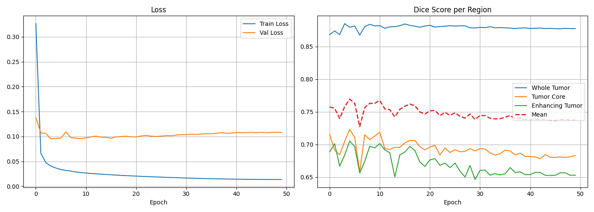

# 🧠 NeuroSegment AI — Brain Tumor Segmentation

[](https://pytorch.org/)
[](https://fastapi.tiangolo.com/)
[](https://www.med.upenn.edu/cbica/brats2020/)
[-6366F1.svg)](#model-architecture)
[](LICENSE)

A full-stack deep learning web application for **automated multi-modal brain tumor segmentation** trained on the **BraTS 2020 (MICCAI)** dataset. Built with **PyTorch**, **FastAPI**, and a **custom glassmorphic dark-theme diagnostic console** featuring interactive canvas overlays, real-time opacity controls, and Sørensen–Dice evaluation.

---

## ✨ Features

- **⚡ Zero-Setup Instant Demo:** Ships with pre-extracted clinical sample cases (`demo_samples/`) ready for single-click neural inference — no external datasets or downloads required.
- **🔬 Multi-Region Tumor Segmentation:** Simultaneously segments all three BraTS clinical sub-regions:
  - **Whole Tumor (WT):** Complete disease extent including edema and core.
  - **Tumor Core (TC):** Surgical resection target (necrotic center + active tumor).
  - **Enhancing Tumor (ET):** Active contrast-absorbing glioma cells.
- **🎨 Interactive Diagnostic Canvas:** High-resolution slice viewport with:
  - Individual sub-region layer visibility toggles (`WT`, `TC`, `ET`).
  - Real-time client-side opacity slider ($0\% - 100\%$) for anatomic correlation.
  - High-resolution composite PNG export.
- **📊 Quantitative Dice Analytics:** Live calculation of Sørensen–Dice similarity coefficients against ground-truth segmentations with animated visual progress bars and voxel volume statistics.
- **📁 Advanced Researcher Mode:**
  - **4-Channel NIfTI Upload:** Ingests raw `.nii` / `.nii.gz` scans (`T1`, `T1ce`, `T2`, `FLAIR` + optional `_seg`), automatically extracts the optimal axial slice, and normalizes volumes.
  - **Preprocessed Array Upload:** Ingests `.npy` 4-channel tensor slices (`[4, 192, 192]`).
- **🚀 Unified Architecture:** FastAPI serves both the REST API and the single-page application from a single lightweight server.

---

## 🏗️ System Architecture

```
brain-tumor-segmentation/
├── ckpt/
│   ├── best.pth                    # Trained U-Net model weights (state dict)
│   └── last.pth
├── demo_samples/                   # Bundled clinical samples for instant demo
│   ├── manifest.json               # Catalog of cases with tumor metadata
│   ├── sample_01_input.npy         # 4-channel float32 slice [4, 192, 192]
│   ├── sample_01_gt.npy            # 3-channel ground truth [3, 192, 192]
│   ├── sample_01_preview.png       # Grayscale thumbnail for gallery
│   └── ...
├── app/                            # Backend FastAPI Service
│   ├── __init__.py
│   ├── model.py                    # U-Net architecture & checkpoint loader
│   ├── inference.py                # Forward pass & Sørensen-Dice engine
│   ├── preprocess.py               # NIfTI & NPY z-score normalization
│   ├── main.py                     # FastAPI REST API endpoints
│   └── requirements.txt            # Python dependencies
├── frontend/                       # Web Client (Vanilla HTML/CSS/JS)
│   ├── index.html                  # Diagnostic console layout
│   ├── style.css                   # Glassmorphic dark theme & animations
│   └── app.js                      # Canvas rendering & API bridge
├── scripts/
│   └── extract_demo_samples.py     # Sample extractor & synthetic case generator
├── training_curves.png             # Training loss and Dice score history
└── README.md
```

---

## 🧠 Medical Imaging & Tumor Nomenclature

The application ingests **four co-registered MRI sequences** conforming to standard neuro-oncology diagnostic protocols:

| Modality | Description | Clinical Utility |
|---|---|---|
| **T1** | T1-weighted spin-echo | Anatomic baseline, tissue boundaries, CSF hypointense |
| **T1ce** | T1-weighted contrast-enhanced | Highlights disrupted blood-brain barrier & active vascular tumor cells |
| **T2** | T2-weighted spin-echo | Highlights edema, fluid accumulation, CSF hyperintense |
| **FLAIR** | Fluid-Attenuated Inversion Recovery | Suppresses CSF signal, hyper-delineates peritumoral vasogenic edema |

### Tumor Sub-Compartment Segmentation

```
┌────────────────────────────────────────────────────────┐
│  Whole Tumor (WT): Red / Coral (#FF5353)               │
│  ┌──────────────────────────────────────────────────┐  │
│  │  Tumor Core (TC): Green / Emerald (#10B981)      │  │
│  │  ┌────────────────────────────────────────────┐  │  │
│  │  │  Enhancing Tumor (ET): Cyan (#00D2FF)     │  │  │
│  │  └────────────────────────────────────────────┘  │  │
│  └──────────────────────────────────────────────────┘  │
└────────────────────────────────────────────────────────┘
```

- **Whole Tumor (WT):** BraTS labels `1 + 2 + 3` (Necrosis + Edema + Enhancing).
- **Tumor Core (TC):** BraTS labels `1 + 3` (Necrosis + Enhancing).
- **Enhancing Tumor (ET):** BraTS label `3` (Active Gd-DTPA enhancing core).

---

## 🔬 Model Details & Performance

- **Architecture:** U-Net with a pre-trained **ResNet-34** encoder backbone (`segmentation-models-pytorch`).
- **Input Dimensions:** `[Batch, 4, 192, 192]` (axial slices, non-zero voxel z-score normalized).
- **Output Channels:** 3 independent sigmoid logits (WT, TC, ET) with a `0.5` decision threshold.
- **Loss Function:** Combined Soft Dice Loss + Binary Cross-Entropy (BCE).

### Validation Results

| Tumor Compartment | Validation Dice | Representative Slice Dice |
|---|:---:|:---:|
| **Whole Tumor (WT)** | **0.880** | **0.978 - 0.987** |
| **Tumor Core (TC)** | **0.723** | **0.682 - 0.834** |
| **Enhancing Tumor (ET)** | **0.705** | **0.952 - 0.980** |
| **Mean Composite** | **0.769** | **0.880 - 0.923** |



---

## ⚡ Quickstart & Running Locally

### 1. Prerequisites
- Python 3.10+ (tested on Python 3.10, 3.11, 3.12, 3.13, 3.14)
- CPU or CUDA-capable GPU (detected automatically)

### 2. Installation

```bash
# Clone the repository
git clone https://github.com/iAhmeed/brain-tumor-segmentation.git
cd brain-tumor-segmentation

# Install dependencies
pip install -r app/requirements.txt
```

### 3. Start the Web Application

```bash
# Start FastAPI with Uvicorn
python -m uvicorn app.main:app --reload --port 8000
```

Open your browser and navigate to:
👉 **[http://localhost:8000](http://localhost:8000)**

*(Interactive Swagger API documentation is available at [http://localhost:8000/docs](http://localhost:8000/docs))*

---

## 🔌 REST API Documentation

| Method | Endpoint | Description |
|---|---|---|
| `GET` | `/health` | System diagnostics, hardware device (`cpu`/`cuda`), and model status |
| `GET` | `/samples` | Catalog of pre-bundled clinical demo cases |
| `GET` | `/samples/{id}/preview` | Returns grayscale PNG thumbnail of the axial slice |
| `POST` | `/predict/sample/{id}` | Runs segmentation on a bundled case; returns masks & Dice scores |
| `POST` | `/predict/upload-npy` | Upload preprocessed `.npy` array (`[4, 192, 192]`) + optional ground truth |
| `POST` | `/predict/upload-nii` | Multi-file upload of 4 NIfTI volumes (`t1`, `t1ce`, `t2`, `flair`, optional `seg`) |
| `POST` | `/predict/upload` | Unified endpoint dynamically routing either `.npy` or NIfTI inputs |

### Example Prediction Response Schema

```json
{
  "sample_id": "01",
  "width": 192,
  "height": 192,
  "masks": {
    "WT": [[0, 0, 1, ...], ...],
    "TC": [[0, 0, 0, ...], ...],
    "ET": [[0, 0, 0, ...], ...]
  },
  "dice": {
    "WT": 0.9800,
    "TC": 0.7144,
    "ET": 0.9656,
    "mean": 0.8867
  },
  "preview_base64": "data:image/png;base64,iVBORw0KGgo..."
}
```

---

## 🛠️ Extracting / Regenerating Demo Samples

If you have access to the raw BraTS training cache (e.g. from Kaggle), you can extract additional custom cases:

```bash
# Extract from BraTS cache directory
python scripts/extract_demo_samples.py --cache /path/to/brats_cache --output demo_samples --count 5

# Or generate synthetic benchmark cases without external dataset
python scripts/extract_demo_samples.py --synthetic --output demo_samples --count 5
```

---

## 📜 Citation & Acknowledgements

- **BraTS 2020:** B. H. Menze, A. Jakab, S. Bauer, et al., *"The Multimodal Brain Tumor Image Segmentation Benchmark (BRATS)"*, IEEE Transactions on Medical Imaging, 2015.
- **Segmentation Models PyTorch:** Pavel Iakubovskii, [segmentation_models.pytorch](https://github.com/qubvel/segmentation_models.pytorch).

---

## 📄 License

This project is licensed under the MIT License. See [LICENSE](LICENSE) for details.
